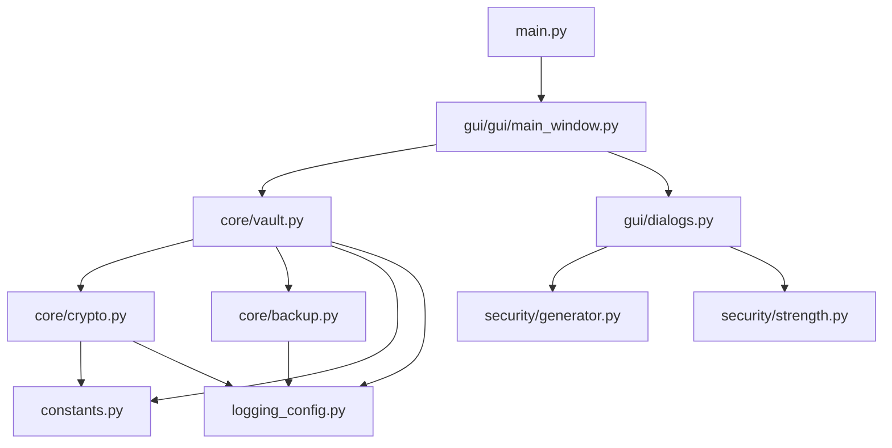

# Password Manager - Technical Documentation

## Table of Contents
1. [Architecture Overview](#architecture-overview)
2. [Encryption & Security](#encryption--security)
3. [Module Breakdown](#module-breakdown)
4. [Data Flow](#data-flow)
5. [Security Analysis](#security-analysis)
6. [Technical Specifications](#technical-specifications)

---

## Architecture Overview

### Design Pattern
The application follows a **layered architecture** with clear separation of concerns:

```
┌─────────────────────────────────────────┐
│         Presentation Layer              │
│  (GUI Components, Main Window)          │
├─────────────────────────────────────────┤
│         Business Logic Layer            │
│  (Password Manager, Backup Manager)     │
├─────────────────────────────────────────┤
│         Security Layer                  │
│  (Crypto Manager, Password Strength)    │
├─────────────────────────────────────────┤
│         Utility Layer                   │
│  (Logger, Constants, Password Gen)      │
└─────────────────────────────────────────┘
```

### Module Dependencies



---

## Encryption & Security

### 1. Master Password Handling

**Process Flow**:
```
User Input → PBKDF2 Key Derivation → AES Encryption Key
```

**Key Derivation (PBKDF2HMAC)**:
- **Algorithm**: PBKDF2 (Password-Based Key Derivation Function 2)
- **Hash Function**: SHA-256
- **Iterations**: 100,000 (configurable in `constants.py`)
- **Salt**: 16 bytes (128 bits), randomly generated once
- **Output**: 32 bytes (256 bits) key

**Why PBKDF2?**
- Industry-standard key derivation function
- Computationally expensive (100,000 iterations) to prevent brute-force attacks
- Uses salt to prevent rainbow table attacks
- Each iteration applies SHA-256 hash function

**Code Implementation** (`core/crypto.py`):
```python
kdf = PBKDF2HMAC(
    algorithm=hashes.SHA256(),
    length=32,              # 256-bit key
    salt=salt,              # 128-bit random salt
    iterations=100000,      # Computational cost
)
key = base64.urlsafe_b64encode(kdf.derive(password.encode()))
```

### 2. Data Encryption (Fernet/AES)

**Encryption Method**: Fernet (Symmetric Encryption)
- **Underlying Algorithm**: AES-128 in CBC mode
- **Authentication**: HMAC using SHA-256
- **IV**: Automatically generated for each encryption

**Fernet Specification**:
```
Version (1 byte) || Timestamp (8 bytes) || IV (16 bytes) || 
Ciphertext (variable) || HMAC (32 bytes)
```

**Why Fernet?**
- High-level cryptographic recipe from `cryptography` library
- Combines encryption (AES) with authentication (HMAC)
- Prevents tampering and ensures data integrity
- Automatic IV generation for each encryption
- Built-in timestamp for key rotation (if needed)

**Encryption Process**:
```
1. Convert password data to JSON
2. Encode JSON to bytes
3. Encrypt with Fernet cipher
4. Write encrypted bytes to file
```

**Code Implementation** (`core/crypto.py`):
```python
# Encryption
data = json.dumps(passwords).encode()
encrypted_data = self.cipher.encrypt(data)

# Decryption
decrypted_data = self.cipher.decrypt(encrypted_data)
passwords = json.loads(decrypted_data.decode())
```

### 3. Salt Management

**Purpose**: Prevent rainbow table attacks

**Storage**: `salt.key` file (16 bytes)

**Generation**: 
```python
salt = os.urandom(16)  # Cryptographically secure random bytes
```

**Lifecycle**:
- Generated once on first run
- Stored persistently in `salt.key`
- Used for all subsequent key derivations
- **Critical**: If lost, encrypted data cannot be recovered

### 4. Password Storage Format

**File**: `passwords.enc` (encrypted binary)

**Unencrypted Structure** (JSON):
```json
{
  "Gmail": {
    "username": "user@example.com",
    "password": "SecureP@ss123",
    "notes": "Personal email account"
  },
  "Facebook": {
    "username": "user@fb.com",
    "password": "AnotherP@ss456",
    "notes": ""
  }
}
```

**Encrypted**: Binary blob with Fernet format

---

## Module Breakdown

### 1. core/crypto.py

**Purpose**: Handle all cryptographic operations

**Key Methods**:

#### `derive_key(password, salt)`
- Derives encryption key from master password
- Uses PBKDF2HMAC with 100,000 iterations
- Returns base64-encoded 256-bit key

#### `initialize(master_password)`
- Loads or creates salt file
- Derives encryption key
- Creates Fernet cipher instance
- Returns True on success

#### `encrypt(data)`
- Encrypts data using Fernet cipher
- Returns encrypted bytes
- Logs errors if encryption fails

#### `decrypt(encrypted_data)`
- Decrypts data using Fernet cipher
- Returns decrypted bytes
- Returns None if decryption fails (wrong password)

**Security Features**:
- No plaintext password storage
- Automatic IV generation
- HMAC authentication
- Comprehensive error handling

---

### 2. core/vault.py

**Purpose**: Core business logic for password management

**Key Methods**:

#### `initialize(master_password)`
```python
def initialize(self, master_password):
    # 1. Initialize crypto with master password
    self.crypto.initialize(master_password)
    
    # 2. Try to load existing encrypted file
    if os.path.exists(self.data_file):
        encrypted_data = read_file()
        decrypted_data = self.crypto.decrypt(encrypted_data)
        
        # 3. If decryption fails, wrong password
        if decrypted_data is None:
            return False
            
        # 4. Parse JSON and load passwords
        self.passwords = json.loads(decrypted_data)
        return True
    else:
        # 5. First time - create empty vault
        self.passwords = {}
        self.save()
        return True
```

#### `save()`
```python
def save(self):
    # 1. Convert passwords dict to JSON
    data = json.dumps(self.passwords).encode()
    
    # 2. Encrypt JSON data
    encrypted_data = self.crypto.encrypt(data)
    
    # 3. Write to file
    with open(self.data_file, 'wb') as f:
        f.write(encrypted_data)
```

#### `add_password(service, username, password, notes)`
- Stores password entry in memory dictionary
- Calls `save()` to encrypt and persist
- Logs operation

#### `export_to_file(filepath)`
- Exports passwords to JSON backup
- Includes metadata (timestamp, version)
- Uses `BackupManager`

#### `import_from_file(filepath, merge_strategy)`
- Imports passwords from JSON backup
- Supports three merge strategies:
  - **Skip**: Keep existing entries
  - **Overwrite**: Replace with imported
  - **Rename**: Add suffix to avoid conflicts

---

### 3. security/strength.py

**Purpose**: Evaluate password strength

**Algorithm**:

```python
def check_strength(password):
    score = 0
    
    # 1. Length scoring
    if length >= 20: score += 2
    elif length >= 16: score += 1.5
    elif length >= 12: score += 1
    elif length >= 8: score += 0.5
    
    # 2. Character variety
    has_lowercase = bool(re.search(r'[a-z]', password))
    has_uppercase = bool(re.search(r'[A-Z]', password))
    has_digits = bool(re.search(r'\d', password))
    has_special = bool(re.search(r'[!@#$...]', password))
    
    variety_count = sum([has_lowercase, has_uppercase, 
                         has_digits, has_special])
    
    if variety_count == 4: score += 2
    elif variety_count == 3: score += 1.5
    elif variety_count == 2: score += 1
    
    # 3. Pattern penalties
    if has_repeating_chars: score -= 0.5
    if has_sequential_numbers: score -= 0.5
    if has_sequential_letters: score -= 0.5
    
    # 4. Common password check
    if in_common_passwords: score -= 2
    
    # 5. Determine strength level
    if score >= 4: return "Very Strong"
    elif score >= 3: return "Strong"
    elif score >= 2: return "Good"
    elif score >= 1: return "Fair"
    else: return "Weak"
```

**Strength Levels**:
- **Weak** (0-1): Short, simple, or common passwords
- **Fair** (1-2): Basic requirements met
- **Good** (2-3): Good length and variety
- **Strong** (3-4): Excellent length and variety
- **Very Strong** (4+): Maximum security

---

### 4. security/generator.py

**Purpose**: Generate cryptographically secure random passwords

**Method**: `generate(length, use_uppercase, use_lowercase, use_digits, use_special)`

**Implementation**:
```python
import secrets  # Cryptographically secure random

def generate(length=16, use_uppercase=True, ...):
    # 1. Build character set
    chars = ""
    if use_uppercase: chars += "ABCDEFGHIJKLMNOPQRSTUVWXYZ"
    if use_lowercase: chars += "abcdefghijklmnopqrstuvwxyz"
    if use_digits: chars += "0123456789"
    if use_special: chars += "!@#$%^&*()..."
    
    # 2. Generate password using secrets module
    password = ''.join(secrets.choice(chars) for _ in range(length))
    
    return password
```

**Why `secrets` module?**
- Designed for cryptographic use
- Uses OS-level random number generator
- More secure than `random` module
- Suitable for passwords, tokens, security keys

---

### 5. core/backup.py

**Purpose**: Handle export/import of password data

**Export Format** (JSON):
```json
{
  "export_date": "2026-01-30T22:00:00",
  "version": "1.0",
  "passwords": {
    "Service1": {...},
    "Service2": {...}
  }
}
```

**Merge Strategies**:

1. **Skip** (Default):
```python
for service, data in imported.items():
    if service not in existing:
        merged[service] = data
    # Skip if exists
```

2. **Overwrite**:
```python
for service, data in imported.items():
    merged[service] = data  # Always overwrite
```

3. **Rename**:
```python
for service, data in imported.items():
    if service in existing:
        new_service = f"{service} (1)"
        while new_service in merged:
            # Increment suffix
        merged[new_service] = data
    else:
        merged[service] = data
```

---

## Data Flow

### 1. First Time Setup

```
┌─────────────────┐
│ User enters     │
│ master password │
└────────┬────────┘
         │
         ▼
┌─────────────────┐
│ Generate random │
│ salt (16 bytes) │
└────────┬────────┘
         │
         ▼
┌─────────────────┐
│ Derive key with │
│ PBKDF2 (100k)   │
└────────┬────────┘
         │
         ▼
┌─────────────────┐
│ Create Fernet   │
│ cipher          │
└────────┬────────┘
         │
         ▼
┌─────────────────┐
│ Create empty    │
│ password vault  │
└────────┬────────┘
         │
         ▼
┌─────────────────┐
│ Encrypt & save  │
│ to passwords.enc│
└─────────────────┘
```

### 2. Adding a Password

```
┌─────────────────┐
│ User fills form │
│ (service, user, │
│  password)      │
└────────┬────────┘
         │
         ▼
┌─────────────────┐
│ Check password  │
│ strength        │
└────────┬────────┘
         │
         ▼
┌─────────────────┐
│ Add to in-memory│
│ dictionary      │
└────────┬────────┘
         │
         ▼
┌─────────────────┐
│ Convert to JSON │
└────────┬────────┘
         │
         ▼
┌─────────────────┐
│ Encrypt with    │
│ Fernet cipher   │
└────────┬────────┘
         │
         ▼
┌─────────────────┐
│ Write to        │
│ passwords.enc   │
└────────┬────────┘
         │
         ▼
┌─────────────────┐
│ Log operation   │
└─────────────────┘
```

### 3. Login Process

```
┌─────────────────┐
│ User enters     │
│ master password │
└────────┬────────┘
         │
         ▼
┌─────────────────┐
│ Load salt from  │
│ salt.key        │
└────────┬────────┘
         │
         ▼
┌─────────────────┐
│ Derive key with │
│ PBKDF2          │
└────────┬────────┘
         │
         ▼
┌─────────────────┐
│ Create Fernet   │
│ cipher          │
└────────┬────────┘
         │
         ▼
┌─────────────────┐
│ Read encrypted  │
│ passwords.enc   │
└────────┬────────┘
         │
         ▼
┌─────────────────┐
│ Try to decrypt  │
└────────┬────────┘
         │
    ┌────┴────┐
    │         │
Success    Failure
    │         │
    ▼         ▼
┌───────┐ ┌───────┐
│ Parse │ │ Show  │
│ JSON  │ │ error │
└───┬───┘ └───────┘
    │
    ▼
┌───────┐
│ Show  │
│ main  │
│ window│
└───────┘
```

---

## Security Analysis

### Threat Model

**Protected Against**:
1. ✅ **Brute Force Attacks**: 100,000 PBKDF2 iterations make each attempt slow
2. ✅ **Rainbow Tables**: Unique salt per installation
3. ✅ **Data Tampering**: HMAC authentication in Fernet
4. ✅ **Plaintext Exposure**: All data encrypted at rest
5. ✅ **Weak Passwords**: Strength checker guides users

**Vulnerabilities**:
1. ⚠️ **Master Password Compromise**: If master password is weak or stolen, all data is accessible
2. ⚠️ **Memory Attacks**: Passwords stored in memory while app is running
3. ⚠️ **Keyloggers**: Cannot protect against keyloggers on compromised systems
4. ⚠️ **Physical Access**: If attacker has access to running application
5. ⚠️ **Backup Files**: Exported JSON files are unencrypted

### Best Practices Implemented

1. **Key Derivation**: PBKDF2 with high iteration count
2. **Authenticated Encryption**: Fernet provides both encryption and authentication
3. **Secure Random**: Uses `secrets` module for password generation
4. **No Password Storage**: Master password never stored, only derived key
5. **Logging**: Audit trail for security review
6. **Input Validation**: Checks for required fields
7. **Error Handling**: Graceful handling of decryption failures

### Recommendations for Users

1. **Strong Master Password**: Use 16+ characters with variety
2. **Unique Master Password**: Don't reuse from other services
3. **Secure Backups**: Encrypt exported JSON files separately
4. **Regular Backups**: Export passwords regularly
5. **Secure Environment**: Use on trusted, malware-free systems
6. **Lock When Away**: Close application when not in use

---

## Technical Specifications

### Cryptographic Parameters

| Parameter | Value | Justification |
|-----------|-------|---------------|
| Key Derivation | PBKDF2HMAC | Industry standard, widely reviewed |
| Hash Function | SHA-256 | Secure, fast, widely supported |
| Iterations | 100,000 | Balances security and performance |
| Salt Length | 16 bytes (128 bits) | NIST recommendation |
| Key Length | 32 bytes (256 bits) | Maximum security |
| Encryption | Fernet (AES-128 CBC) | High-level, authenticated encryption |
| HMAC | SHA-256 | Ensures data integrity |

### Performance Characteristics

**Key Derivation Time** (PBKDF2 with 100,000 iterations):
- Modern CPU: ~100-200ms
- Older CPU: ~300-500ms

**Encryption/Decryption**:
- Negligible for typical password vault sizes (<1ms)

**Memory Usage**:
- Minimal: ~10-20MB for typical usage
- Scales with number of passwords

### File Sizes

| File | Typical Size | Notes |
|------|-------------|-------|
| `passwords.enc` | ~1-10 KB | Depends on number of passwords |
| `salt.key` | 16 bytes | Fixed size |
| `password_manager.log` | Grows over time | Rotate periodically |

---

## Logging System

### Log Levels

1. **DEBUG**: Detailed information for debugging
   - Key derivation
   - Encryption/decryption operations

2. **INFO**: General informational messages
   - Vault initialization
   - Password additions/deletions
   - Export/import operations

3. **WARNING**: Warning messages (currently unused)

4. **ERROR**: Error conditions
   - Decryption failures
   - File I/O errors
   - Import failures

### Log Format

```
2026-01-30 22:00:00,123 - PasswordManager - INFO - Loaded 5 passwords from encrypted file
2026-01-30 22:00:15,456 - PasswordManager - INFO - Added/updated password for service: Gmail
2026-01-30 22:00:30,789 - PasswordManager - ERROR - Failed to decrypt password file - incorrect master password
```

### Log File Location

`password_manager.log` in application directory

**Rotation**: Manual (consider implementing automatic rotation for production)

---

## Constants Configuration

All configurable values in `constants.py`:

```python
# Encryption
PBKDF2_ITERATIONS = 100000  # Increase for more security
KEY_LENGTH = 32             # Don't change
SALT_LENGTH = 16            # Don't change

# Password Generator
DEFAULT_PASSWORD_LENGTH = 16  # Default generated length
MIN_PASSWORD_LENGTH = 8       # Minimum allowed
MAX_PASSWORD_LENGTH = 64      # Maximum allowed

# GUI
WINDOW_WIDTH = 800
WINDOW_HEIGHT = 600
```

**Customization**: Edit `constants.py` to change application behavior

---

## Future Enhancements

### Potential Improvements

1. **Two-Factor Authentication**: Add TOTP support
2. **Password History**: Track password changes
3. **Auto-Lock**: Lock after inactivity
4. **Clipboard Clearing**: Auto-clear clipboard after copy
5. **Password Expiration**: Remind users to change old passwords
6. **Secure Notes**: Store other sensitive information
7. **Browser Integration**: Browser extension for auto-fill
8. **Cloud Sync**: Encrypted cloud backup (with caution)
9. **Biometric Unlock**: Fingerprint/face recognition
10. **Password Sharing**: Securely share passwords with others

### Security Enhancements

1. **Argon2**: Consider switching from PBKDF2 to Argon2 (more resistant to GPU attacks)
2. **Memory Protection**: Use secure memory for sensitive data
3. **Key Rotation**: Implement periodic master key rotation
4. **Encrypted Backups**: Encrypt exported JSON files
5. **Secure Deletion**: Overwrite files before deletion

---

## Conclusion

This password manager implements industry-standard cryptographic practices:
- **PBKDF2** for key derivation (100,000 iterations)
- **Fernet/AES** for authenticated encryption
- **Secure random** for password generation
- **Comprehensive logging** for audit trails

The modular architecture ensures maintainability and extensibility while maintaining security best practices.

**Remember**: Security is only as strong as the master password. Choose wisely! 🔐
